<div align="center">
  
  <h1>Tap Board</h1>

  <p>A touch-first web app with simple helpers for board-game players — roll dice, track scores, count life totals, time turns, and more.</p>

  [](#none)
  [](https://jamesread.github.io/tap-board/)
  [](https://github.com/jamesread/tap-board/pkgs/container/tap-board)
  [](https://www.gnu.org/licenses/agpl-3.0)
</div>

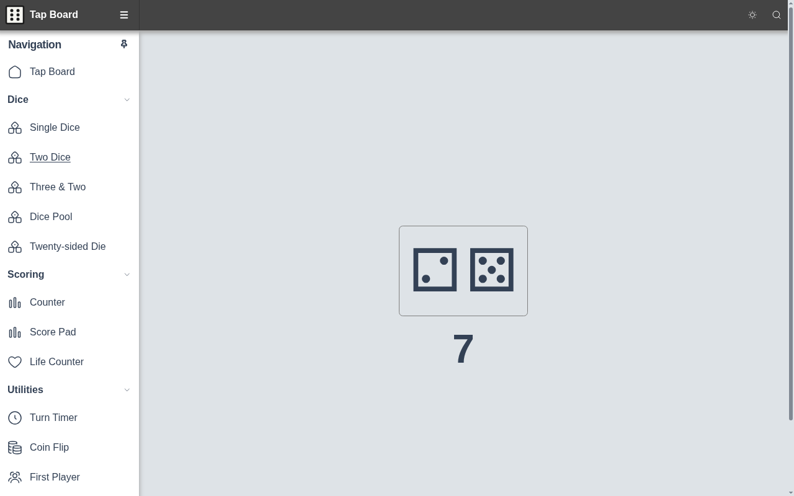

Built with Vue 3 and [PicoCrank](https://github.com/jamesread/picocrank). The app is fully static; no backend is required.

## Examples

Each helper is a full-screen board with large tap targets, designed for use on a phone or tablet during play.

### Dice

Tap anywhere on a board to roll.

| Two dice | Three & two | Dice pool | Twenty-sided die |
|---|---|---|---|
| 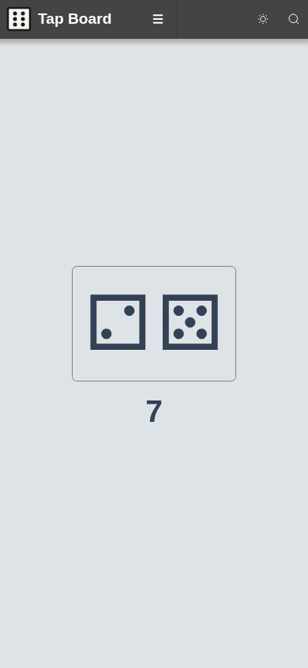 | 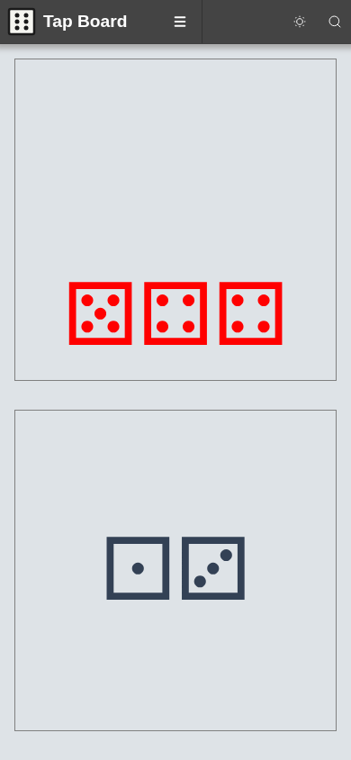 | 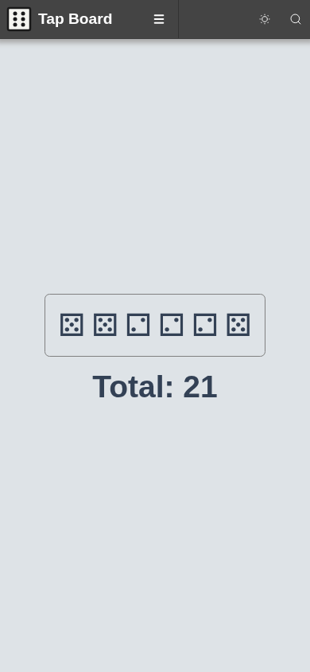 | 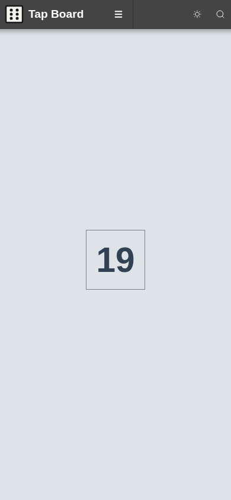 |

### Scoring

Tap a player's name to rename them; press and hold `+` / `−` to change values quickly.

| Counter | Score pad | Life counter |
|---|---|---|
| 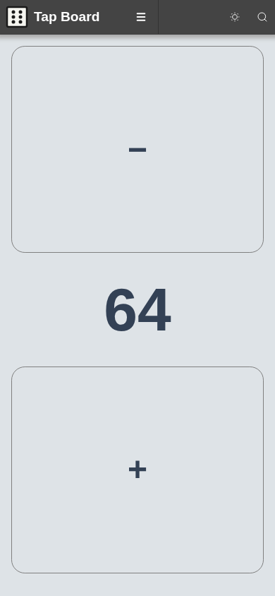 | 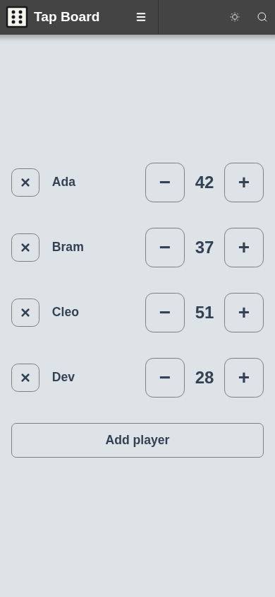 | 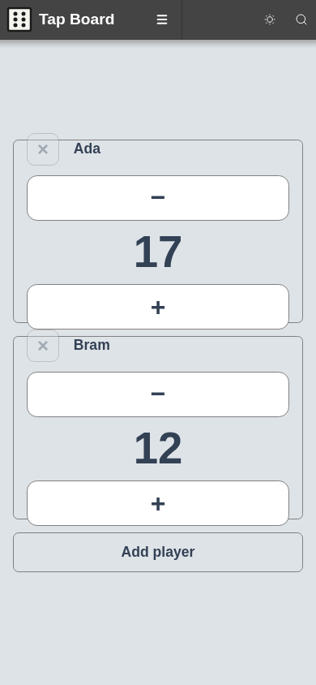 |

### Utilities

| Turn timer | Coin flip | First player |
|---|---|---|
| 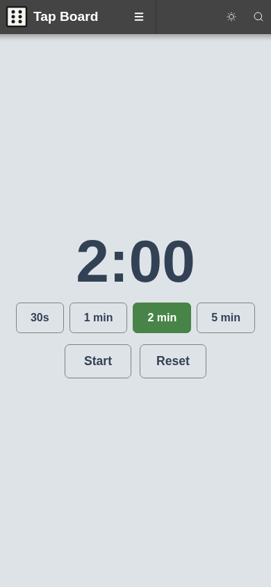 | 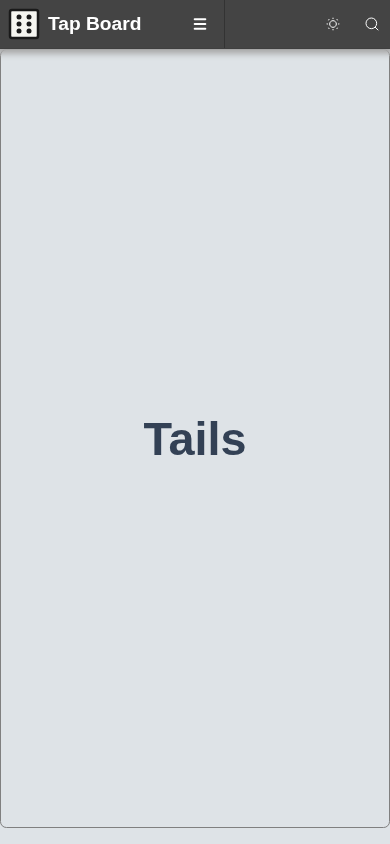 | 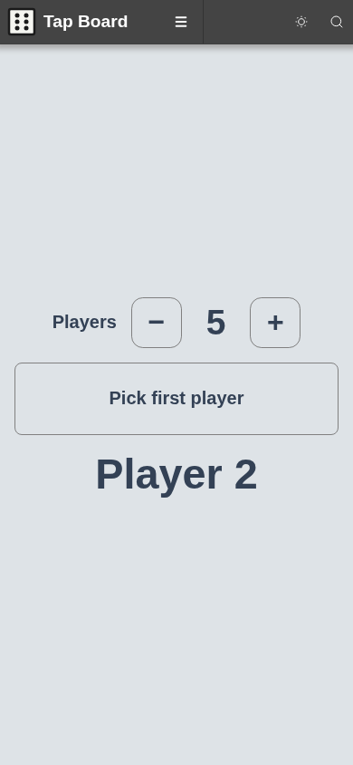 |

### Dark mode

Use the theme toggle in the header to switch between light and dark.

| Desktop | Phone |
|---|---|
| 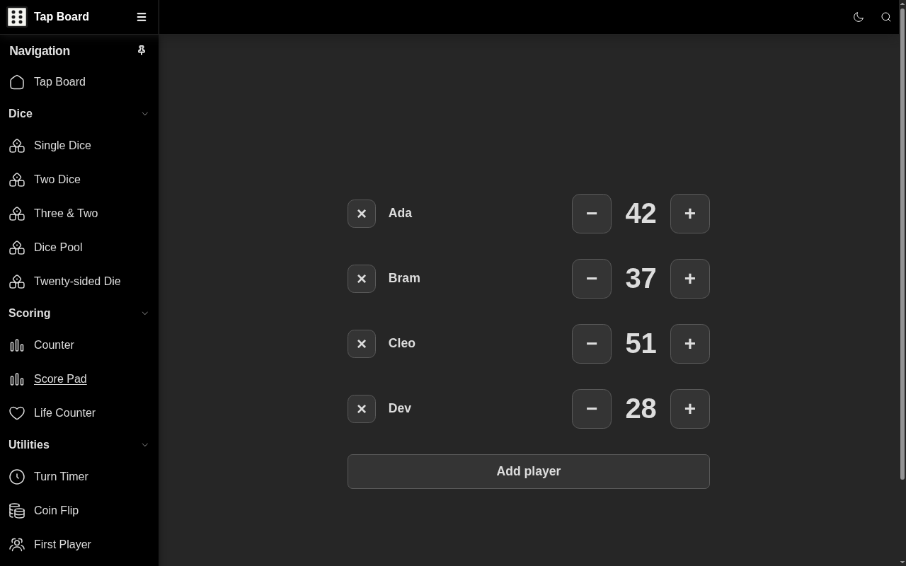 | 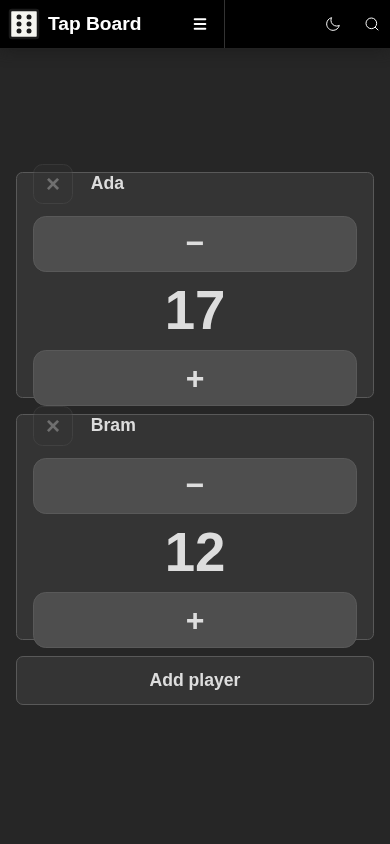 |

## Hosted version

There is a hosted, up-to-date version at https://jamesread.github.io/tap-board/ — deployed from `master` by the `pages` workflow.

## Running with Docker

Pre-built images are published to [GitHub Container Registry](https://github.com/jamesread/tap-board/pkgs/container/tap-board):

```bash
docker pull ghcr.io/jamesread/tap-board:latest
docker run --rm -p 8080:8080 ghcr.io/jamesread/tap-board:latest
```

Open [localhost:8080](http://localhost:8080).

### Build locally

```bash
docker build -t tap-board .
docker run --rm -p 8080:8080 tap-board
```

Or use the Makefile:

```bash
make container    # build and run locally
make publish      # build and push to ghcr.io (requires login)
```

## Screenshots

Screenshots use fictional game state and are regenerated with `make screenshots`
(see [`var/marketing/screenshots`](var/marketing/screenshots/README.md)).
